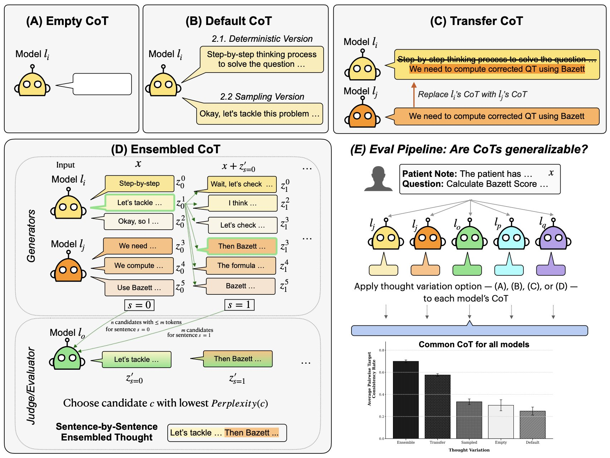

<h1 align="center"> 🤖🤝🤖 Explanation persuasiveness 🤖🤝🤖 </h1>
<p align="center"> <b>Persuasiveness of chain-of-thought explanations across LLMs</b>  (<a href="https://arxiv.org/abs/2601.11517">Pal, Bau, & Singh, arXiv 2026</a>). 
</p>


<p align="center">
  
  
</p>  




# Code overview

Note that this repository is still being cleaned up. The contents presently consist of raw dumps from two separate forked repositories that were used during our research. If you want to use this immediately (whether the data or the RL trained models or other additional questions), please contact the authors (contact details withheld for anonymous review).

The repository is organized into two main directories corresponding to the datasets we worked with:

- Medcalc-Bench
    - Originally forked from: https://github.com/ncbi-nlp/MedCalc-Bench
    - All newly developed code related to this dataset is located in the evaluation/ folder.
- Instruction-Induction
    - Originally forked from: https://github.com/orhonovich/instruction-induction
    - Additional scripts and related code have been added directly within this directory.

```
